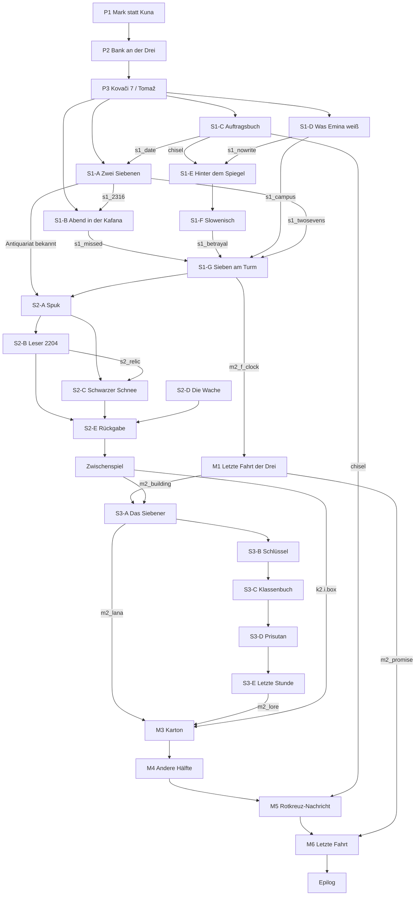

# MALA – Kapitel 2: Sarajevo

Entwurf, Handlung und Rätselarchitektur. Dieses Dokument ist die verbindliche Grundlage für Kunst, Skripte und Tests. Es verrät alles; die Lösung für Spieler steht in `LOESUNG2.md`.

> **Umsetzung:** Kapitel 2 ist nach diesem Entwurf gebaut. Die gemessenen Werte (Zeilen, Optionen, Schlüsse, Hinweise), alle ausgeführten Tests und die Abweichungen vom Entwurf stehen in [`BERICHT_K2.md`](BERICHT_K2.md). Zwei Ergänzungen gegenüber diesem Entwurf: Auch der Nebengeist Alija hat eine Erkenntnisszene (beim Einsteigen in die letzte Drei), und die Hinweise umfassen 50 Themen statt der hier geplanten.

---

## 0. Bestandsaufnahme: Split gemessen, Ziele für Sarajevo

Gezählt im Quelltext von Kapitel 1 (Stand dieses Commits):

| Größe | Split (Kapitel 1) | Ziel Sarajevo | Grundlage des Ziels |
|---|---|---|---|
| Schauplätze (begehbare Räume) | 18 (+ Stadtplan, Zwischenwelt) | 18 (+ Stadtplan, Zwischenwelt) | 12–18 gefordert; dichter gestaltet |
| Gesprochene Zeilen (Figuren, Marko, Mala, Erzähler) | 1271 | ≥ 1910 | +50 % |
| davon Marko ↔ Mala | 242 Mala-Zeilen | ≥ 400 Mala-Zeilen | „deutlich mehr Interaktion“ |
| Beschreibungstexte („Schau an“) | 399 | ≥ 500 | |
| Auswahloptionen | 237 | ≥ 360 | +50 % |
| Mehrstufige Rätselketten | 12 (meist 2–4 Schritte) | 24 (3–15 Schritte) | +50 % und 12–16 gefordert |
| Bedeutungsvolle Rätsel- und Erkenntnisschritte | ca. 55 | ≥ 110 | 35–50 gefordert, +50 % |
| Ketten mit mehreren funktionalen Figurenwechseln | 3 | ≥ 12 | ≥ 7 gefordert |
| Figuren mit eigenem Rig | 16 | 16 neue (+ Marko, Mala) | |
| Gemalte Porträts | 15 | 20 neue | |
| Musikstücke | 11 | 8 neue | sieben Themen gefordert |
| Klangkulissen | 20 | 19 neue | |
| Erinnerungsbilder (Nachhall) | 14 | 14 neue | |
| Spielzeit | 2–3 h (Schätzung) | 4–5 h (Schätzung) | |

Rätselketten in Split (zur Einordnung): Schuhkarton und Knoten · Archiv und Band 1948 · Fahrtenbuch und Schlussfolgerung · Dinko und Seesack · salziger Brief · Konfrontation mit Ivka · Handschuhe in der Zwischenwelt · Bauzaun und Ledana · Kühlraum im Dunkeln · Radio, Batterien, Kassette · Ninas Zettel · Bruno und das Salonfinale.

---

## 1. Die Grundidee

**Zentrale Frage:** Was verbindet Mala mit Sarajevo, und warum kann sie sich an entscheidende Ereignisse ihrer Vergangenheit nicht erinnern?

**Antwort, die sich erst im Finale ganz zusammensetzt:**
- Mala ist **Lana Delić**, geboren 1976, aus dem Hochhaus Nr. 7 in Alipašino Polje (B-Phase), neunter Stock. Marko wohnte im selben Haus, im siebten Stock. Sie war zwei Jahre älter und brachte ihn jeden Samstag mit der **Linie 3** zu seiner Großmutter Ruža nach Vratnik. Sie nannte ihn „Mali“, er sie aus Trotz „Mala“. **„Mala“ ist der Name, den Marko ihr gegeben hat.**
- Im November 1993 bekam Lana einen Platz in einem Bus aus der Stadt, und Markos Großmutter einen zweiten für Marko. Lana kaufte bei Alija am Kiosk zwei Fahrscheine der Linie 3, „für die erste Drei nach dem Krieg“, zerriss ihr gemeinsames Foto und gab Marko Fahrschein und Fotohälfte: „Wenn wir uns wiedersehen, passen sie zusammen.“ Marko versprach zu kommen. Er kam nicht: Die Großmutter lag mit Lungenentzündung, und er traute sich nicht, Lana das zu sagen. Lana wartete am Treffpunkt, bis der Bus abfuhr.
- In Split wohnte Lana in Zimmer 31 des Hotel Palma und wartete jeden Abend auf der Treppe (Kapitel 1). Im Dezember 1993 schickte sie eine **Rotkreuz-Nachricht**: „Mali, ich warte jeden Abend auf der Treppe. Wenn du nicht kommst, komme ich dich holen.“ Die Großmutter bekam sie im Januar 1994, schon sehr krank, und legte sie in das Wärmefach ihres Kohleofens, „für später, wenn er stärker ist“. Sie starb im Februar. Marko hat die Nachricht nie gesehen.
- Im Januar 1994 verließ Lana Split, um Marko zu holen (Register: „Abreise: –“). Sie kam nie an. Für ihre Mutter gilt sie bis heute als vermisst. Was unterwegs geschah, bleibt für Kapitel 3 (Mostar) offen; in Sarajevo erinnert sie sich nur noch an einen Lastwagen, **eine Brücke, die nicht mehr da war**, und Wasser.
- Marko kam im Mai 1994 allein nach Split. Er glaubte, Lana habe ihn vergessen, fragte vergeblich nach ihr und klebte den Karton „SARAJEVO“ zu. Er hat sie **verdrängt**, nicht nur die Belagerung.
- **Warum Mala nicht erinnert:** In der Welt von MALA erinnern sich die Toten mit den Lebenden, die an ihnen hängen. Mala ist an Marko gebunden. Wo er vergessen hat, ist sie leer. Das sagte Kapitel 1 schon leise: „Da drin ist kein Nachhall. Der Nachhall ist in dir.“ Erst als Marko sich erinnert, erinnert sie sich. Ihr Gedächtnis kommt in **Splittern** zurück, jeder an einem Ort oder Ding, an dem Marko etwas wiederfindet.

**Themen:** Erinnern und Vergessen, wer die Erinnerung hält (die Lebenden, die Toten, Dokumente, die Stadt), verpasste Begegnungen, Versprechen. Jeder Fall spiegelt einen Teil davon: zwei, die beide kamen, nur nicht zur selben Zeit (Fall 1); einer, der die Erinnerung einer ganzen Bibliothek aufhob (Fall 2); eine, die die Namen der Kinder bewachte, damit sie nicht verloren gehen (Fall 3).

**Ton:** wie Kapitel 1 ernst, ruhig, melancholisch, mit mehr Wärme und mehr trockenem Sarajevoer Humor. Der Krieg ist Hintergrund, nie Kulisse. Keine Nationalitäten-Zuschreibungen; Namen, Feste und Klänge sind einfach Teil der Stadt.

---

## 2. Kontinuität mit Split

**Gesetzt in Kapitel 1** (darf nicht widersprochen werden): Marko, geboren 1978 in Sarajevo, Hochhausviertel, Großmutter in der Altstadt nahe der Linie 3; kam 1994 allein nach Split; sagt nie „Belagerung“, sondern „damals“. Karton „SARAJEVO“ auf dem Schrank, seit 1994 zugeklebt; umgedrehtes Foto: Junge im gestreiften Pullover, Großmutter, Linie 3. Mala: wirkt 17–18, Jeansjacke, grauer Schal, Zopf; Blechdose wie aus einer Hilfslieferung; Straßenbahn 3, Kohleöfen, „dass man im Winter den Himmel nicht sah“; zuckt bei Kirchenglocken, hält bei Fährenhörnern inne. Register Hotel Palma, Zimmer 31: „…ić, L., 17, Sarajevo. Ankunft 28.11.1993. Abreise: –“. Nachtbuch: „Die Kleine aus 31 wartet wieder auf der Treppe.“ Kreide im Salon: Straßenbahn 3, Mädchen mit Zopf, „KUĆA“. Epilog: Mala öffnet die Dose (Ticket und halbes Foto mit gestreiftem Ärmel); „Ich habe hier im Winter auf einen Bus gewartet. Auf einen, der nach Hause fährt.“

**Gewählte Richtung:** Vorschlag A aus Kapitel 1 (die Nachbarin aus dem Hochhaus), verbunden mit C (das Foto in der Dose). B (Familie) wird ausgeschlossen. Fährenhörner (Dubrovnik) und der Weg über Mostar (Brücke, Konvoi) bleiben offen; Glocken bleiben offen.

**Übernommen aus dem Spielstand von Split** (falls vorhanden, sonst Standardwerte):
- `i1.answer` (warum er in Split blieb) und `i1.sarajevo` (warum er nicht zurückging) → Malas Erwiderungen im Prolog und im Zwischenspiel.
- Die Notizen `m_register`, `m_journal`, `m_31`, `m_chalk`, `m_sarajevo`, `m_waited`, `m_tin`, `m_bells` (Gruppe „Aus Split“) stehen in Sarajevo im Notizbuch und werden für Schlussfolgerungen gebraucht.
- Ljerkas Honorar ist ausgegeben (Busfahrkarte). Marko hat seine Džezva, sein Telefon und ein paar Kuna.

**Historische Treue (November 2011):** Vijećnica Baustelle (Wiedereröffnung erst 2014); Trebević-Seilbahn außer Betrieb (bis 2018); Straßenbahnen meist Tatra K2 (Linie 3: Ilidža – Baščaršija, die Eins fährt zum Bahnhof); Fahrschein 1,60 KM am Kiosk, 1,80 KM beim Fahrer, im Wagen entwerten; Sahat-kula zeigt Mondzeit, zwölf bei Sonnenuntergang, wird von Hand gestellt; ICAR-Dosen-Denkmal (2007) beim Historischen Museum; Avaz-Turm und BBI stehen; Sarajevo City Center gibt es noch nicht. Im November liegen Nebel und Kohlerauch über dem Tal. In Alipašino Polje gab es im Krieg „Treppenhausschulen“. Rotkreuz-Nachrichten waren der verlässlichste Weg zur Familie. Alle Figuren sind erfunden; keine realen Opfer, Amtsträger oder Familien.

---

## 3. Zeit und Phasen

| Phase (`M.PHASES`) | Tageszeit | Wetter | Abschnitt | Wann |
|---|---|---|---|---|
| `k2_pro` | dusk | fog | Prolog – Die Linie Drei | Samstag, 19. November 2011 · Nachmittag |
| `k2_pro_n` | night | fog | Prolog, Nacht | Samstag · Nacht |
| `k2_s1` | day | fog | Erster Fall – Sieben am Turm | Sonntag, 20. November · Tag |
| `k2_s1_n` | night | calm | Erster Fall, Nacht | Sonntag · Nacht |
| `k2_s2` | day | rain | Zweiter Fall – Die Leihfrist | Montag, 21. November · Regen |
| `k2_s2_n` | night | rain | Zweiter Fall, Nacht | Montag · Nacht |
| `k2_i` | night | calm | Zwischenspiel – Die Gelbe Bastei | Montag · spät |
| `k2_s3` | day | fog | Dritter Fall – Das verschlossene Zimmer | Dienstag, 22. November · Nebel |
| `k2_s3_n` | night | fog | Dritter Fall, Nacht | Dienstag · Nacht |
| `k2_fin` | day | calm | Finale – Malas Spur | Mittwoch, 23. November · klar, kalt |
| `k2_fin_n` | night | snow | Finale, Nacht | Mittwoch · Nacht, erster Schnee |
| `k2_epi` | dawn | snow | Epilog – Der erste Schnee | Donnerstag, 24. November · Morgen |

Neues Wetter `fog` (Nebelschleier, Kohlerauch, gedämpfte Lichter) und `snow` (erster Schnee). Fall-Codes für das Notizbuch: `p2` Prolog, `s1`, `s2`, `s3`, `m2` Malas Vergangenheit (dazu `mala` aus Split), `f2` Finale.

---

## 4. Figuren

### Hauptfiguren
- **Marko Vuković (33).** In Sarajevo zum ersten Mal seit 17 Jahren. Wortkarg, präzise, trockener Humor; hier zusätzlich unsicher, weil die Stadt ihn kennt, bevor er sie wiedererkennt. Entwicklung: vom Ausweichen („damals“) zum Erinnern und zu einem Versprechen, das er diesmal hält. Seine Stärke: Er **übersetzt** (Deutsch, Italienisch, Englisch, liest Slowenisch und Kurrent) und redet mit Lebenden.
- **Mala (Lana Delić, 17).** In Sarajevo unruhiger, schneller gereizt, verletzlicher. Sie erkennt Dinge, ohne zu wissen woher. Neckt Marko für seinen dalmatinischen Akzent, streitet mit ihm über Vorgehen und über das Erinnern („Du willst es nicht wissen.“ – „Und du?“). Lernt am Ende ihren Namen von ihm.

### Lebende Nebenfiguren
| Figur | Alter | Ort | Persönlichkeit, Sprechweise | Motivation / Geheimnis |
|---|---|---|---|---|
| **Fikret Hadžić** | 54 | Buregdžinica am Busbahnhof | laut, gutmütig, Fußballnarr (Željo), Sarajevoer Sprüche, „Burek ist nur mit Fleisch!“ | hält einen Brief aus Graz für eine Beschwerde; ist es nicht |
| **Senada** | 61 | Kiosk am Bahnhof | knapp, korrekt, „Kune? Ne.“ | – |
| **Hajra Mešić** | 72 | Pension in Kovači | warm, neugierig, füttert, redet mit ihrer Katze Mačak, Witwe | war Nachbarin von Markos Großmutter Ruža; hat den Schlüssel zu Ružas Haus |
| **Rade Simić** | 63 | Fahrdienstleiter-Häuschen an der Wendeschleife Baščaršija | genau, ironisch, liebt seine Straßenbahnen, führt Buch über jede Abfahrt | fuhr in den 80ern samstags die Drei; erinnert sich an „die Kleine mit dem Jungen“ |
| **Emina Kadić** | 58 | Kafana „Kula“ | stolz, scharf, traditionell (keine Espressomaschine!), Witwe | wartete 1972 eine Nacht unter dem Uhrturm; glaubt seit 39 Jahren, versetzt worden zu sein |
| **Lejla Kadić** | 16 | Kafana „Kula“ | schlagfertig, Handy, will nach Wien (Geige), nennt Marko „der Übersetzer aus Split“ | hilft im Café; braucht Hilfe bei einem deutschen Bewerbungsbrief |
| **Šaćir Mehmedović** | 81 | Fenstertisch der Kafana | schwerhörig, erzählt in Schleifen, Domino, „Damals, mein Sohn …“ | war 1972 Kellner; gab Halid etwas „für Emina“ und hält es seither für übergeben |
| **Nedžad Kazandžić** | 41 | Werkstatt in Kazandžiluk | arbeitet beim Reden weiter (Hämmern, Gravieren), ruhig, stolz aufs Handwerk | hat die Auftragsbücher seines Großvaters auf dem Dachboden |
| **Jakob Kabiljo** | 71 | Antiquariat in einer Passage an der Ferhadija | ironisch, gebildet, „Ich verkaufe Erinnerungen nach Gewicht“, zitiert gern | in seinem Laden spukt es, seit er ein Buch ausgestellt hat |
| **Amra Begović** | 31 | Baustelle Vijećnica (Tag) | begeistert, Restauratorin, hat in Wien studiert, spricht Deutsch | kann eine Bauakte in Kurrent nicht lesen |
| **Ilija Perišić** | 62 | Nachtwache Vijećnica | brummig, Ex-Polizist, Schach, Thermoskanne | lässt nur mit Passierschein hinein |
| **Milka Đurić** | 85 | Obala, Bank vor Nr. 14 | fütterte schon 1992 die Tauben; erinnert sich genau | sah den Professor am Morgen nach dem Brand auf dem Balkon |
| **Dragica Lukić** | 79 | Eingangshalle Haus 7 | wacht auf ihrem Stuhl über das Haus, Kanarienvogel, scharfer Witz | kennt Marko als „Mali Marko vom Siebten“ |
| **Nada Delić** | 61 | Haus 7, 9. Stock | müde, scharf, unterschreibt nichts mehr | Lanas Mutter; hält Lanas Zimmer seit 1993 verschlossen; Lana gilt als vermisst |
| **Mirza Hodžić** | 26 | Hausmeister Haus 7 | praktisch, wortkarg, an der linken Hand fehlen zwei Finger | war in der Kellerschule; die Lehrerin trug ihn 1994 verwundet hinein |
| **Sulejman Šehić** | 66 | Hausrat, 2. Stock | pedantisch, Stempel und Beschlüsse, einsam | hat den Schutzraum 1998 zugesperrt; seine Frau Hanka saß dort im Krieg |
| **Selma Karić** | 27 | Haus 7, 3. Stock | offen, müde, Baby Amar, der Aufzug ist kaputt | war in der Kellerschule, 2. Klasse |
| **Damir Kovač** | 34 | Straßenbahnfahrer Linie 3 | zynisch, schnell, „Ich fahre nach vorn, nicht zurück“ | war in der Kellerschule; hat eine Zeichnung behalten |
| **Fadila** | 50 | Paketschalter Busbahnhof | gelangweilt, gründlich | gibt den Karton nur gegen Nummer und Ausweis heraus |
| **Sanja** (Split) | 32 | nur am Telefon | wie in Kapitel 1 | schickt den Karton mit dem Bus |
| **Petar Barać** | 55 | nur am Telefon (Wien) | höflich, schuldbewusst | verkaufte die Bücher seines Vaters |

### Geister
| Geist | Gestorben | Ort | Woran er hängt | Leugnen |
|---|---|---|---|---|
| **Tomaž Zupan** | 2009, Ljubljana, mit 58 | unter dem Uhrturm (Sahat-kula) | an der Verabredung vom 14.11.1972 „wenn die Kula sieben schlägt“ | für ihn ist es der 14.11.1972, er ist 21 und muss um halb zwölf in der Kaserne sein |
| **Prof. Ivan Barać** | 2003, mit 82 | Antiquariat und Vijećnica | an einem Bibliotheksbuch, das er 1992 auslieh und nie zurückgeben konnte | für ihn läuft die Frist am 7.9.1992 ab |
| **Zora Marić** | 1998, mit 61 | Schutzraum im Keller von Haus 7 | an den Namen der Kinder ihrer Kellerschule und an einem Versprechen: Zeugnisse mit Stempel | für sie ist Januar 1994, draußen wird geschossen |
| **Alija** (Nebengeist) | 1995 | Stelle des alten Kiosks an der Haltestelle Alipašino Polje | an seinem Kiosk | verkauft weiter Fahrscheine; begreift es, als die letzte Drei mit seinen gelochten Fahrscheinen kommt |

Aussehen der Geister (lesbar, siehe Geisterdarstellung): Tomaž braune Cordjacke, Hemd mit breitem Kragen, Koteletten, schulterlanges Haar, kleines Schmuckkästchen; Ivan Tweedmantel, Schal, runde Brille, weißes Haar, ein Buch unter dem Arm; Zora grauer Knoten, Strickjacke, Brille an Kette, Kreide an den Fingern, Handglocke; Alija Schiebermütze, Weste, Zeitungsbündel.

---

## 5. Schauplätze (18 + Stadtplan + Zwischenwelt)

| ID | Ort | Funktion |
|---|---|---|
| `stanica` | Busbahnhof und Bahnhof (Modernebau mit Uhr), Kiosk, Buregdžinica, Taxis, Paketschalter | Ankunft (P1), Paket (M3), Epilog |
| `tramvaj` | Innenraum einer Tatra K2, Entwerter, Fenster mit vorbeiziehender Stadt | Fahrt im Prolog, letzte Fahrt (M6) |
| `carsija` | Baščaršija: Sebilj, Tauben, Wendeschleife mit Rades Häuschen, Ćevabdžinica, Fahrleitungen | Drehscheibe, Mala wartet (P2), Rade (M1) |
| `kula` | Hof unter der Sahat-kula, Mauer der Moschee, Terrasse der Kafana „Kula“ | Fall 1 |
| `kafana` | Kafana „Kula“ innen: Kupfertabletts, Fenstertisch, Theke, Tür zur Kammer | Fall 1 |
| `ostava` | Kammer hinter der Kafana (Mala durch die Tür, Marko mit Schlüssel), großer alter Spiegel | Fall 1 (S1-E) |
| `kazandziluk` | Kupferschmiedgasse mit Nedžads offener Werkstatt, Leiter zum Dachboden | Fall 1 (S1-C) |
| `pansion` | Markos Zimmer bei Hajra in Kovači: Bett, Fenster über die Stadt, Telefon im Flur, Ofen | Heimat, Telefonate |
| `ferhadija` | Fußgängerzone, Kathedrale (Glocken!), Ewige Flamme, Passage zum Antiquariat, „Sarajevoer Rose“ im Pflaster | Fall 2 |
| `antikvarijat` | Jakobs Laden: Regale, Glasvitrine, Fotokiste, Zeitungsbündel, Lesesessel, Türglocke | Fall 1 (Takvim), Fall 2, M1 (Foto) |
| `obala` | Ufer der Miljacka, Lateinerbrücke, Haus Obala 14 mit Balkon, Vijećnica mit Gerüst und Bauzaun | Fall 2 |
| `vijecnica` | Innen: Atrium mit Gerüst, Glaskuppel, Ausleihtheke, verbrannte Säulen | Fall 2 |
| `neboder` | Hof von Haus 7 in Alipašino Polje (Hochhaus, ausgebrannte Dachuhr), Haltestelle Linie 3, Spielplatz, alte Kioskstelle | M1, Fall 3 |
| `haustor` | Eingangshalle Haus 7: Briefkästen, Hausbuch im Glaskasten, Aufzug „VAN FUNKCIJE“, Dragicas Stuhl, Hausmeisterraum, Stahltür zum Schutzraum, Klingelknopf der Kellerschule | Fall 3 |
| `skloniste` | Schutzraum: Bänke, Tafel, Kinderzeichnungen (Straßenbahnen), Schrank, Pult, Handglocke, Ofenrohr | Fall 3 |
| `stan` | Nadas Wohnung im 9. Stock: Küche, Balkon mit Blick über die Hochhäuser, Lanas verschlossene Tür und Zimmer | Fall 3, Finale |
| `vratnik` | Vratnik: steile Gasse, Großmutters Haus mit Hof, Stadtmauer, Žuta tabija mit Blick über das Tal | Zwischenspiel, Finale |
| `kuca` | Großmutters Küche: Kohleofen mit Wärmefach, Tisch, Fenster, Kalender von 1994 | Finale |
| `map2` | Stadtplan Sarajevo: Tal der Miljacka von West nach Ost, Linie 3, Hügel | Reisen |
| `limbo` | Zwischenwelt (aus Kapitel 1) mit neuen Bruchstücken: Zifferblatt der Kula, Lesesaal-Tisch, Schulbank mit Glocke | Erlösungen |

Stadtplan-Orte: Busbahnhof, Baščaršija, Kazandžiluk, Kula, Kovači (Pension), Ferhadija, Miljacka/Vijećnica, Alipašino Polje, Vratnik. Sie erscheinen, wenn jemand von ihnen erzählt hat.

---

## 6. Neue Mechaniken (alle in der bestehenden Engine)

1. **Malas Splitter.** Wo Marko an etwas aus ihrer gemeinsamen Vergangenheit rührt, kehrt Mala ein Bruchstück zurück: ein kurzes Erinnerungsbild und eine Notiz in der Gruppe „Splitter“ (Fall `m2`, Markierung `frag`). Splitter allein lösen nichts; zusammen mit Markos Fakten ergeben sie Schlüsse.
2. **Zwei Blicke auf dasselbe.** Viele Orte zeigen in Malas Sicht andere Dinge (Nachhall, Kreide, Leinen, Geisterobjekte, Inschriften unter Farbe). Rätsel verlangen, beide Blicke zu vergleichen: Markos Beobachtung und Malas Beobachtung sind getrennte Notizen.
3. **Mehrstufige Schlussfolgerungen.** A + B = C, C + D = E (bestehendes System; Schlüsse sind wieder Notizen). Falsche Kombinationen erzeugen kurze, figurenbezogene Antworten (je nach gespielter Figur und Fall, nicht immer derselbe Satz).
4. **Widersprüche.** Zwei Aussagen, die sich widersprechen, ergeben eine Notiz „Widerspruch“, mit der man nachfragen kann.
5. **Synchron handeln, ohne Zeitdruck.** Mala bleibt in einem Raum, den Marko nicht betreten kann; Marko löst anderswo etwas aus (Klingel, Licht, Uhr); wechselt man zurück, hat sich bei Mala etwas verändert. War sie nicht am richtigen Ort, passiert nichts Sichtbares, und man versucht es erneut.
6. **Übersetzen.** Markos Beruf wird Werkzeug: deutsche, slowenische und in Kurrent geschriebene Texte, mit Auswahl-Rätseln (falsche Freunde, Tonfall, Reihenfolge).
7. **Hinweise auf Wunsch.** Im Menü „Hinweis“: Liste der offenen Probleme, je drei Stufen (Erinnerung an das Problem, Ort/Person/Ding, konkreter Denkanstoß). Nie ungefragt, nie automatisch gelöst.
8. **Unruhe der Geister** (`npc.agitate`) vor der Erkenntnis, **Erkenntnis-Effekt** (`A.realize`, 5 s) bei Tomaž, Ivan und Zora.

---

## 7. Rätselketten

Notation: **[M]** Marko, **[G]** Mala, `note` = Notiz-ID, `item` = Gegenstand-ID, `k2.*` = Flag. „→“ = schaltet frei.

### Prolog

**P1 – Mark statt Kuna** (Ankunft; nur Marko, Mala fehlt)
- Ausgang: Busbahnhof, Nachmittag, Nebel. Mala ist bei der Einfahrt verschwunden, der Wechselknopf ist leer.
- Ziel: mit der Straßenbahn in die Altstadt.
- Schritte: [M] Kiosk: Fahrschein 1,60 KM, „Kune? Ne.“ → `p2_km`. · [M] Wechselstube „subotom do 14h“, Automat „van funkcije“, Taxi will 20 Euro. · [M] Fikret schimpft über einen Brief aus Graz → Brief lesen (Dokument) → Übersetzung wählen (Auswahl: drei Deutungen; nur die richtige: Reisegruppe bestellt 40 Burek für Montag 7:30) → Fikret zahlt 10 KM und einen Burek → `item km`. · [M] Fahrschein kaufen → `item tramkarta`. · [M] Haltestelle → Eins nach Baščaršija (`tramvaj`). · [M] im Wagen Fahrschein entwerten (sonst Kontrolleur: einmalige Strafe, dann geht es weiter).
- Hinweise: 1 „Ich brauche Mark, nicht Kuna.“ 2 „Fikret kämpft mit einem deutschen Brief.“ 3 „Lies ihm den Brief richtig vor, er zahlt dich dafür.“

**P2 – Die Bank an der Drei** (Mala kehrt zurück)
- Ausgang: Wendeschleife Baščaršija; Mala sitzt blass auf der Bank der Linie 3, steigt in keine ein.
- Schritte: [M] mit Mala reden: „Ich warte auf die Drei. Ich weiß nicht, auf wen.“ · [M] Rade fragen, ob heute noch eine besondere Drei fährt → „Jede ist die Drei.“ · [M] den entwerteten Fahrschein Mala zeigen → Splitter **F1** `m2_f_saturday` („Die Löcher. Samstags. Wir.“) → Mala steht auf, Wechsel frei. · [M] Rade fragt nach Markos Namen, kennt „eine Ruža Vuković aus Vratnik“ → `p2_rade_ruza`, Weg nach Kovači.
- Hinweise: 1 „Mala wartet, ohne zu wissen worauf.“ 2 „Was hat sie früher mit der Drei verbunden?“ 3 „Zeig ihr deinen entwerteten Fahrschein.“

**P3 – Kovači 7** (Ankunft in der Pension; Erzählung)
- Hajra empfängt Marko (Sanjas Tante), Kaffee aus ihrer und seiner Džezva: „Das ist Ružas Džezva. Ich erkenne die Gravur.“ → `p2_hajra`. Zimmer; Telefon im Flur; Fenster über die Stadt. Nacht: Mala hört einen Mann bei der Kula singen → Prolog, Nacht: an der Kula wartet ein junger Mann in Cordjacke und fragt nach der Uhrzeit (Tomaž) → `s1_tomaz`. Um elf verblasst er. Schlafen → Fall 1.

### Fall 1 – Sieben am Turm

Wahrheit: 14.11.1972. Eminas Zettel an Tomaž: „Sutra, kad kula udari sedam, pod satom. – E.“ (Morgen, wenn die Kula sieben schlägt, unter der Uhr.) Sie meinte Mondzeit (sieben Stunden nach Sonnenuntergang, 23:16), er 19 Uhr. Er wartete erst draußen, dann in der Kafana, bis Halid (Eminas Vater) um 23 Uhr früh zusperrte; um 23:30 musste er in der Kaserne sein, am Morgen wurde er entlassen und heimgeschickt. Bevor er ging, gab er dem Kellner Šaćir das Armband „für Emina, falls sie kommt“. Šaćir gab es Halid, Halid versteckte es mit Tomažs sechs Briefen aus Ljubljana hinter dem Spiegel der Kammer. Emina kam um 23:16 und wartete bis zum Morgen.

**S1-A – Zwei Siebenen** (Zeit) · [M][G][M]
- [M] Tomaž: „Sie kommt um sieben. Sie hat es geschrieben.“ · [G] Mala liest den Zettel in seiner Hand (Geisterobjekt) → `s1_note`. · [M] Turmuhr ansehen: um halb acht zeigt sie Viertel nach drei → `s1_clock`. · [M] Lejla (oder Schild am Turm) erklärt die Mondzeit → `s1_alaturka`. · Schluss `s1_note`+`s1_alaturka` → **`s1_twosevens`** („Ihre Sieben war nicht seine.“) · [M] Takvim 1972 im Antiquariat lesen (nur mit Datum sinnvoll, siehe S1-C) → `s1_sunset` (14.11.1972: 16:16) · Schluss `s1_twosevens`+`s1_sunset` → **`s1_2316`** („Die Kula schlug sieben um 23:16.“)
- Hinweise: 1 „Tomaž und die Uhr am Turm sind sich nicht einig.“ 2 „Wann zeigt die Kula zwölf? Frag jemanden aus der Kafana.“ 3 „Ein alter Takvim mit den Sonnenuntergängen von 1972 hilft, mit dem genauen Datum.“

**S1-B – Der Abend in der Kafana** (Aussagen) · [M][G][M]
- [M] Šaćir mit `s1_tomaz` fragen → `s1_soldier` (wartete drinnen, fragte jede Viertelstunde nach der Zeit), `s1_closed` (Halid sperrte um elf zu, sonst erst um Mitternacht). · [M] Tomaž: „Um halb zwölf muss ich in der Kaserne sein.“ → `s1_curfew`. · Schluss `s1_closed`+`s1_curfew` → **`s1_left`** („Er ging kurz nach elf. Er musste.“) · Schluss `s1_left`+`s1_2316` → **`s1_missed`** („Elf Minuten.“)
- Hinweise: 1 „Wer war an jenem Abend in der Kafana?“ 2 „Der alte Kellner am Fenster erinnert sich, wenn man ihn richtig fragt.“ 3 „Verbinde, wann er ging, mit der Zeit, als die Kula sieben schlug.“

**S1-C – Das Auftragsbuch** (Datum) · [G][M][G][M]
- [G] In Malas Sicht hält Tomaž ein Kästchen mit einem gravierten Armband → `s1_bracelet`. · [M] Tomaž: „Aus der Čaršija, ein Meister hat es gemacht.“ · [M] Nedžad hämmert; der Dachboden mit den Büchern seines Großvaters ist nur über die Leiter erreichbar, und er hat keine Zeit: Ein Wiener Kunde will eine Gravur „Für immer – E.“, und Nedžad kennt die deutschen Buchstaben nicht. · [M] Gravurvorlage richtig schreiben (Auswahl mit ß/Umlauten) → Nedžad holt das Buch von 1972 → lesen: `s1_date` (14.11.1972), `s1_name` (Tomaž Zupan, Ljubljana; abgeholt 18:40). · [G] Nachhall an der Werkbank: Tomaž beim Abholen: „Heute sagt sie es ihrem Vater.“ → `s1_father`. · Nedžad leiht das Stemmeisen → `item chisel` (für S1-E).
- Hinweise: 1 „Woher stammt das Armband?“ 2 „In Kazandžiluk werden seit Generationen Gravuren gemacht; Nedžad hat alte Bücher.“ 3 „Hilf Nedžad mit der deutschen Gravur, dann hat er Zeit.“

**S1-D – Was Emina weiß** (Dialog, Widerspruch) · [M][G][M]
- [M] Emina: „Kaffee. Mehr gibt es hier nicht.“ Mit `s1_name` oder `s1_bracelet` fragen → „Raus.“ · [G] Mala lauscht Emina und Lejla hinter der Theke → `s1_waited` („Ich habe die ganze Nacht unter der Uhr gewartet. Er kam nicht.“) · Widerspruch `s1_waited`+`s1_soldier` → **`s1_both`** („Beide haben gewartet. Nicht zur selben Zeit.“) · [M] Lejla fragen → `s1_married` (Eminas Vater verheiratete sie 1975), `s1_campus` (die alte Kaserne ist heute der Campus). · [M] Emina mit `s1_missed` → sie hört zu, glaubt es nicht: „Und warum hat er nie geschrieben?“ → `s1_nowrite`.
- Hinweise: 1 „Emina redet nicht über 1972.“ 2 „Vielleicht redet sie mit ihrer Enkelin.“ 3 „Lass Mala hinter der Theke zuhören.“

**S1-E – Hinter dem Spiegel** (Raum) · [M][G][M][G][M]
- [M] Šaćir mit `s1_nowrite` → `s1_gave` („Der Soldat gab mir etwas für Emina. Ich gab es Halid.“) · [G] Mala geht durch die Kammertür: Nachhall 1973, Halid schiebt eine Blechkasse hinter den großen Spiegel → `s1_hidden`. · [M] Kammer verschlossen; Emina trägt den Schlüssel. Lejla hilft, wenn Marko ihren deutschen Bewerbungsbrief korrigiert (drei Sätze, Auswahl) → sie verspricht die Kammer, „wenn Oma weg ist“. · [G] Mala lauscht: Emina geht am Nachmittag zu ihrer Schwester → `s1_away`. · [M] am Nachmittag öffnet Lejla die Kammer; dunkel und vollgestellt. · [G] wechseln: der Nachhall leuchtet hinter dem Spiegel. · [M] Spiegelrahmen mit `chisel` lösen → Blechkasse → `item letters_tz` (sechs Briefe), `item bracelet`.
- Hinweise: 1 „Wo sind Tomažs Briefe geblieben?“ 2 „Halid hat alles aufgehoben. Die Kammer ist verschlossen.“ 3 „Lejla hat Zugang, wenn Emina fort ist. Mala sieht, wo.“

**S1-F – Slowenisch** (Übersetzung) · [M]
- [M] Briefe lesen; der wichtigste in einem Übersetzungsrätsel (vier Wendungen, falsche Freunde) → `s1_letters` („Ich habe bis elf gewartet. Um halb zwölf musste ich in der Kaserne sein. Ich schreibe, bis du antwortest.“) · Schluss `s1_letters`+`s1_hidden` → **`s1_betrayal`** („Halid hat die Briefe versteckt.“)

**S1-G – Sieben am Turm** (Finale Fall 1) · [M][G][M][G]
- [M] Emina Briefe und Armband geben, dann in der richtigen Reihenfolge `s1_missed` und `s1_betrayal` vorlegen (falsche Reihenfolge: sie wendet sich ab, man beginnt neu) → sie liest, weint, zieht das Armband an: „Heute Nacht. Wenn die Kula sieben schlägt.“ → `k2.s1.emina`. · Nacht: [M] um elf will Tomaž gehen; ihn halten mit `s1_campus` („Die Kaserne gibt es nicht mehr“) und `s1_twosevens` („Sie kommt, wenn die Kula sieben schlägt“); falsche Argumente lassen ihn unruhiger werden, er bleibt aber bis Viertel nach. · 23:16: die Kula schlägt sieben, Emina kommt. Tomaž sieht eine alte Frau mit seinem Armband. **Erkenntnis** (`A.realize('tomaz')`): „Neununddreißig Jahre … Ich bin in Ljubljana gestorben. Es hat geschneit.“ Emina spricht in die Leere: „Ich war da.“ → Leine löst sich. · [G] Hinüberbringen → Zwischenwelt: Zifferblatt der Kula zeigt drei; [M] Zeiger auf sieben stellen → die Kula schlägt, Tomaž geht. · Splitter **F2** `m2_f_clock` („Wir trafen uns auch unter einer Uhr. Einer mit leuchtenden Ziffern.“)
- Hinweise: 1 „Emina muss die Wahrheit in der richtigen Reihenfolge hören.“ 2 „Erst wann, dann warum er nie schrieb.“ 3 „In der Nacht: Halte Tomaž mit dem, was Lejla über die Kaserne sagte.“

### Malas Spur, erster Teil

**M1 – Die letzte Fahrt der Drei** (über Fall 1 und 2) · [M][G][M][G][M][G][M]
- [M] In Jakobs Fotokiste: Haltestelle mit Hochhaus und einer Uhr auf dem Dach, 1987 → `item photo_stop`, `m2_photo`. · [G] Foto Mala zeigen: Nachhall „Halt dich fest, Mali!“, Samstag, 11:10 → Splitter **F3** `m2_f_voice`. · [M] Rade mit dem Foto: alte Lage der Haltestelle Alipašino Polje, „nach dem Krieg verlegt“; „die 11:10 am Samstag bin ich jahrelang gefahren“; „nur ein Hochhaus hatte eine Uhr auf dem Dach: das Siebener in der B-Phase, ausgebrannt '92“ → `m2_stop`, `m2_clocktower`; „da stiegen immer zwei Kinder ein, sie nannte ihn Mali“ → `m2_kids`. · Schluss `m2_f_clock`+`m2_clocktower` → **`m2_building`** („Mala kennt das Siebener.“) → Stadtplan: Alipašino Polje. · [G] am Hof von Haus 7: an der alten Kioskstelle steht Alija (nur Mala sieht ihn): „Zwei Fahrscheine für die Kleine und den Mali.“ Er erinnert sich lückenhaft: „Das letzte Mal kaufte sie zwei. Für später, hat sie gesagt.“ → `m2_alija`. · [M] Mala bitten, die Dose zu öffnen: erst „Meins.“; mit `m2_alija` zeigt sie nur den Fahrschein: Linie 3, entwertet am 12.11.1993 mit Alijas Sternzange → `m2_ticket`. · [M] Rade: „Im November '93 fuhr keine einzige Bahn.“ → `m2_notrams`. · Widerspruch `m2_ticket`+`m2_notrams` → **`m2_promise`** („Ein Fahrschein für eine Fahrt, die es nicht gab. Ein Versprechen.“) · [G] Splitter **F4** `m2_f_ninth` („Neunter Stock. Der Aufzug ging nie.“) · [M] Marko, leise: „Ich habe auch im Siebener gewohnt.“ → `m2_marko7`; öffnet Fall 3.
- Hinweise: 1 „Ein altes Foto hat Mala erschreckt.“ 2 „Rade kennt jede Haltestelle von damals.“ 3 „Frag Mala nach ihrem Fahrschein, wenn du weißt, wer ihn verkauft hat.“

### Fall 2 – Die Leihfrist

Wahrheit: Prof. Ivan Barać lieh am 24.8.1992 Rilkes „Duineser Elegien“ (Insel 1923, Bibliotheksstempel, Leser 2204, Frist 7.9.1992), um seine Übersetzung zu beenden. In der Nacht zum 26.8. brannte die Bibliothek. Am Morgen fing er auf seinem Balkon an der Obala verbrannte Seiten, die wie schwarzer Schnee fielen, und legte sie in das Buch: Er wollte der Bibliothek zurückgeben, „was der Himmel mir gegeben hat“. Er starb 2003. Sein Sohn verkaufte die Bücher 2004 an Jakob. Seit Jakob das Buch im Oktober ausstellte, spukt es.

**S2-A – Spuk im Antiquariat** · [M][G][M]
- [M] Jakob erzählt vom Spuk (Bücher fallen, die Türglocke läutet nachts) → `s2_spook`. · [G] Mala findet im Lesesessel einen alten Mann mit Brille, der durch das Glas der Vitrine liest: „Ich muss es zurückgeben. Die Frist läuft ab.“ → `s2_ivan`, `s2_due`. · [G] Mala liest den Leihzettel im verschlossenen Buch: „NUB BiH · Leser 2204 · Rückgabe 7. IX 1992“ → `s2_stamp`. · [M] Vitrine verschlossen, Preis 900 KM; ein Sammler aus Frankfurt hat geschrieben (Marko übersetzt: Kauf nächste Woche) → `s2_buyer`.
- Hinweise: 1 „In Jakobs Laden liest jemand, der nicht da ist.“ 2 „Mala kann lesen, was im verschlossenen Buch steht.“ 3 „Ein Buch mit Bibliotheksstempel gehört nicht in eine Vitrine.“

**S2-B – Leser 2204** (Herkunft) · [M][G][M]
- [M] Jakobs Ankaufbuch: „2004, Nachlass Prof. I. B., Obala 14, verkauft von P. Barać, Wien“, mit Telefonnummer → `s2_ledger`. · [G] Mala spürt im Zeitungsstapel Trauer: Oslobođenje 2003 → [M] Nachruf lesen: „Prof. Ivan Barać, Übersetzer Rilkes …“ → `s2_obit`. · Schluss `s2_stamp`+`s2_ledger` → **`s2_provenance`** („Das Buch gehört der Bibliothek.“) · [M] aus der Pension Petar in Wien anrufen (auf Deutsch): „Vater hütete es wie eine Reliquie. Er sagte, er müsse es zurückgeben.“ → `s2_relic`.
- Hinweise: 1 „Wer war Leser 2204?“ 2 „Jakob schreibt auf, von wem er kauft.“ 3 „Ruf den Verkäufer an. Er spricht Deutsch.“

**S2-C – Schwarzer Schnee** (Zeit, Malas Splitter) · [M][G][M]
- [M] Milka an der Obala: „Am Morgen nach dem Brand stand er auf dem Balkon und fing Asche, mit beiden Händen.“ → `s2_ash`. · [G] Mala an der Lateinerbrücke: Nachhall 26.8.1992, Seiten fallen wie schwarzer Schnee; auf der Brücke fängt ein Mädchen ein Blatt → Splitter **F5** `m2_f_snow` („Ich habe auch eins gefangen. Ich habe es jemandem geschenkt.“) · Schluss `s2_ash`+`s2_relic` → **`s2_fragments`** („Im Buch liegen die verbrannten Seiten.“)
- Hinweise: 1 „Warum war ihm gerade dieses Buch so wichtig?“ 2 „Eine alte Nachbarin an der Obala hat ihn damals gesehen.“ 3 „Verbinde, was Milka sah, mit dem, was sein Sohn sagte.“

**S2-D – Die Wache** (Zugang) · [M][G][M]
- [M] Bauzaun der Vijećnica, tagsüber Amra: Sie hat eine Bauakte von 1894 in Kurrent gefunden und kann sie nicht lesen. · [M] Kurrent-Tafel aus Jakobs Laden → drei Wörter entziffern (Zuordnungsrätsel) → Amra gibt einen Passierschein für heute Abend → `item pass`. · [G] Mala geht durch den Zaun und sieht im Lesesaal den Professor an der verbrannten Ausleihtheke warten: „Geschlossen. Wieder geschlossen.“ → `s2_desk`. · [M] Nacht: Ilija prüft den Schein.
- Hinweise: 1 „In die Vijećnica kommt nachts niemand.“ 2 „Die Restauratorin braucht jemanden, der alte deutsche Schrift liest.“ 3 „Jakob hat eine Kurrent-Tafel.“

**S2-E – Rückgabe** (Finale Fall 2) · [M][G][M][G]
- [M] Jakob mit `s2_provenance` und `s2_relic`: „Ich bin Antiquar, kein Hehler.“ → `item rilke`. · Nacht, Vijećnica: [M] das Buch auf die Ausleihtheke legen; [G] Mala liest ein eingelegtes Blatt vor; der Professor sieht Gerüst, Kuppel, Staub und das Datum. **Erkenntnis** (`A.realize('ivan')`): „Neunzehn Jahre. Ich habe die Frist überzogen.“ · [M] Rückgabevermerk „Vraćeno, 21.11.2011“ in den Leihzettel schreiben → Leine löst sich. · [G] Hinüberbringen → Zwischenwelt: Lesetisch; „Mir fehlt eine Zeile.“ [M] die fehlende Zeile übersetzen (Auswahl; richtig ist, was seine Notizen nahelegen) → er geht. · Amra verspricht, das Buch der Nationalbibliothek zu übergeben.
- Hinweise: 1 „Jakob gibt das Buch nur, wenn er weiß, wem es gehört.“ 2 „Zurückgegeben wird es dort, wo es ausgeliehen wurde.“ 3 „Leg es auf die alte Ausleihtheke.“

### Zwischenspiel – Die Gelbe Bastei (Montag, spät)
- Auf der Žuta tabija über der Stadt im Nebel. Gespräch mit Auswahl (beeinflusst Markos Offenheit im Finale): Malas Splitter „Du hattest einen Pullover mit Streifen.“ – die offene Frage aus Split (der gestreifte Ärmel) bekommt Gewicht. Marko erzählt von seinem Vater (oder schweigt). Er entscheidet: „Ich rufe Sanja an. Sie soll mir den Karton schicken.“ → `k2.i.box`.

### Fall 3 – Das verschlossene Zimmer

Wahrheit: Zora Marić hielt 1992–1995 im Schutzraum von Haus 7 Schule, mit älteren Helfern (Lana Delić für Zeichnen). Sie schrieb Zeugnisse, aber ohne Stempel, weil die Schule zerstört war, und versprach: „Ihr bekommt Zeugnisse mit Stempel. Damit es zählt.“ Am 22.1.1994 lief der neunjährige Mirza in der Pause hinaus und wurde von Splittern getroffen; sie trug ihn hinein. Er überlebte. Zora glaubte bis zuletzt, er sei gestorben und es sei ihre Schuld; im Klassenbuch steht „Mirza H. – ranjen. Moja krivica.“ Sie starb 1998. Šehić sperrte den Schutzraum zu.

**S3-A – Das Siebener** (Ankunft, Erkundung) · [M][G]
- [M] Dragica erkennt Marko: „Mali Marko vom Siebten!“ → `s3_dragica`; erzählt vom Haus, von „Lehrerin Zora unten im Keller“ → `s3_zora`, von „Nada vom Neunten“ → `s3_nada`. · [M] Hausbuch im Glaskasten (Mieter 1991) lesen: 7. Stock Vuković, 9. Stock Delić (Esad, Nada, Lana) → `m2_housebook`. · Schluss `m_register`+`m2_housebook` (mit `m2_f_ninth`) → **`m2_lana`** („Mala ist Lana Delić vom neunten Stock?“). Mala: „Lana. Das klingt wie jemand anderes.“ Marko: „Ich weiß, dass dort jemand wohnte. Ich sehe kein Gesicht.“ · [G] Mala geht durch die Stahltür: im Dunkeln eine Frau an der Tafel, die Namen aufruft → `s3_roll`.

**S3-B – Der Schlüssel des Hausrats** · [M][G][M]
- [M] Šehić verweigert den Schlüssel („Nur mit Beschluss!“). · [G] Mala lauscht vor seiner Tür: er spricht mit dem Foto seiner Frau: „Ich habe den Keller zugesperrt, Hanka. Damit keiner mehr da unten sitzen muss.“ → `s3_hanka`. · [M] Šehić mit `s3_hanka` (behutsam wählen) → Schlüssel für heute, „bringen Sie ihn zurück und erzählen Sie mir, was unten ist“ → `item key_shelter`. · Alternative (wenn man es anders versucht): Mirza kennt den Notausstieg unter dem Sandkasten, aber nur mit Brecheisen und Šehićs Erlaubnis; beide Wege führen zum selben Ziel.

**S3-C – Das Klassenbuch** (Synchron) · [M][G][M][G][M]
- [M] mit dem Schlüssel in den Schutzraum: dunkel, Schrank verschlossen; Zora sieht er nicht deutlich. · Mirza: „Früher klingelte es unten, wenn oben jemand den Knopf drückte. Damit die Kinder kamen.“ → `s3_bell`. · [G] Mala in den Schutzraum stellen, [M] oben den Klingelknopf drücken, [G] zurück zu Mala: Zora hört die Klingel, „Pause vorbei!“, und holt den Schrankschlüssel unter dem Pult hervor (Nachhall) → `s3_deskkey`. War Mala nicht unten: „Unten hat es geklingelt. Gehört hat es keiner.“ · [M] Schlüssel unter dem Pult, Schrank öffnen → `item dnevnik`, `item svjedocanstva`. · [M] Klassenbuch lesen → `s3_register` (Namen), `s3_guilt` („Mirza H. – ranjen. Moja krivica.“), `s3_helper` (Lana Delić, Helferin Zeichnen), `m2_pupil` (Marko Vuković, 8. Klasse).

**S3-D – Prisutan** (Schüler finden, Stempel) · [M][G][M]
- [G] Zora: „Wenn alle da sind, verteile ich die Zeugnisse. Mit Stempel.“ → `s3_stamp`. · [M] Mirza mit `s3_stamp`: in seiner Kiste aus der zerstörten Schule liegt der Rundstempel → `item pecat`. · [M] Ehemalige Schüler gewinnen: **Mirza** will nicht hinunter; mit `s3_guilt`: „Ihre Schuld? Sie hat mich hineingetragen!“ → `s3_rescued`, er kommt. **Selma** kommt, wenn Marko den Kinderwagen in den dritten Stock trägt (Aufzug kaputt). **Damir** an der Haltestelle: „Ich fahre nach vorn, nicht zurück.“ Mit dem Klassenbuch (seine Zeichnung, `s3_register`) kommt er. · Widerspruch `s3_guilt`+`s3_rescued` → **`s3_truth`** („Sie hielt für Schuld, was eine Rettung war.“)

**S3-E – Die letzte Stunde** (Finale Fall 3) · [M][G][M][G]
- [M] im Schutzraum die Zeugnisse stempeln, dann die Namen aufrufen (Klassenbuch). Jeder Lebende antwortet „Prisutan/Prisutna“. Bei „Mirza Hodžić“ steht ein erwachsener Mann mit vernarbter Hand auf. Zora sieht ihn. **Erkenntnis** (`A.realize('zora')`): „Du lebst. Und ich nicht.“ · [M] „Lana Delić.“ Stille. [G] Mala: „Prisutna.“ Zora: „Lana. Du und der kleine Vuković, immer die Straßenbahnen.“ → `m2_lana_teacher`. · [M] „Marko Vuković.“ – „Prisutan.“ · Zora zu Mala: „Wir Toten erinnern uns mit den Lebenden, Kind. Du bist so leer, weil einer dich vergessen hat.“ → **`m2_lore`**. · [G] Hinüberbringen → Zwischenwelt: Schulbank mit Glocke; [M] Zora die Handglocke geben, sie läutet: „Die Stunde ist aus.“ · Šehić bekommt den Schlüssel zurück.

### Finale – Malas Spur

**M3 – Der Karton aus Split** · [M]
- [M] (nach dem Zwischenspiel) aus der Pension Sanja anrufen: sie schickt den Karton mit dem Bus, Ankunft Mittwoch 14 Uhr, Nummer per SMS. · [M] Handy leer → in der Pension laden → SMS: „Paket 4471“ → `f2_parcel`. · [M] Paketschalter: Nummer und Ausweis → `item karton`. · [M] Marko öffnet den Karton erst, wenn er `m2_lana` und `m2_lore` hat („Noch nicht.“ – „Jetzt.“): `item photo_m` (seine Fotohälfte), `item sweater`, `item ticket_m` (zweiter Fahrschein, 12.11.1993, Sternzange), `item ashpage` (verbranntes Blatt: Šantić, „Emina“), `item drawing` (Kinderzeichnung einer Drei, signiert „Mali“).

**M4 – Die andere Hälfte** · [M][G][M]
- [M] Mala `ticket_m` zeigen: zwei Fahrscheine, dieselbe Sternzange → sie öffnet die Dose ganz. · [M] die beiden Fotohälften aneinanderlegen (Puzzle: Rissränder ausrichten) → Großmutter, Marko mit zehn im gestreiften Pullover, Lana mit Zopf, Hand in Hand vor einer Drei, auf der Rückseite „Mala & Mali, 1988 · Nana Ruža“ → `f2_photo`. · Marko erinnert sich: „Lana.“ Erinnerungsfolge (Samstage, die Drei, „Mali“/„Mala“, der Keller, der schwarze Schnee, die zwei Fahrscheine, die Nacht des Busses, zu der er nicht kam) → `f2_memory`. · Mala: „Ich habe gewartet. Auf der Treppe. Dann bin ich gegangen. Ich weiß nicht, wohin.“

**M5 – Die Nachricht vom Roten Kreuz** · [M][G][M][G][M]
- [M] Nada (9. Stock): mit `f2_photo` erkennt sie Marko: „Mali.“ Sie öffnet Lanas Zimmer zum ersten Mal seit 1993. → `f2_room`. · [G] Mala in Lanas Zimmer: Nachhall, sie selbst mit 17 beim Zeichnen; „Mama.“ Nada hört es nicht. · [M] Postkarte aus Split, Januar 1994, an der Wand: „Mama, ich komme nach Hause. Ich hole Mali.“ → `f2_postcard`; „Sie ist nie angekommen. Sie gilt als vermisst.“ → `f2_missing`. · [M] Hajra gibt den Schlüssel zu Ružas Haus („Sie hätte gewollt, dass du hineingehst.“) → `item key_kuca`. · [G] in Ružas Küche: Nachhall Januar 1994, die Großmutter liest ein Formular des Roten Kreuzes, weint, legt es ins Wärmefach des Ofens → `f2_oven`. · [M] Wärmefach verrostet → mit `chisel` aufhebeln → `item rcm` → lesen: „Mali, ich warte jeden Abend auf der Treppe im Hotel Palma. Wenn du nicht kommst, komme ich dich holen. Meinen Fahrschein habe ich noch. Hast du deinen? Mala. 18.12.1993“ → `f2_rcm`. · Schluss `f2_rcm`+`f2_postcard` → **`f2_cameback`** („Sie fuhr los, um mich zu holen.“) · Schluss `f2_cameback`+`m_register` → **`f2_whyabreise`** („Darum steht bei Abreise nichts.“)

**M6 – Die letzte Fahrt der Drei** (Höhepunkt) · [M][G][M]
- [M] Nacht, Haltestelle Alipašino Polje, erster Schnee: mit beiden Fahrscheinen in die Drei. · [M] seinen Fahrschein entwerten; Mala gibt Marko ihren (zum ersten Mal gibt sie etwas her), er entwertet auch ihn. · Fahrt bis Baščaršija mit Erinnerungen an den Haltestellen (Marijin Dvor, ICAR-Dose: „Meine ist kleiner.“). · an der Endhaltestelle: Markos Geständnis (Auswahl, keine falsche Antwort, nur andere Worte) · Mala: „Du bist gekommen. Nur später.“ Sie sagt ihren Namen: „Lana.“ Ihr letzter Splitter: ein Lastwagen, eine Brücke, die nicht mehr da war, Wasser → `f2_bridge`. Ihre Leine zeigt nicht mehr nach Osten, sondern nach Südwesten.

### Epilog – Der erste Schnee
- Morgen, Schnee. Marko bei Nada: er gibt ihr die Rotkreuz-Nachricht; „Ich finde heraus, wo sie geblieben ist.“ – „Bring sie mir nach Hause.“ · optional ein Anruf bei seiner Schwester Ana in München. · Busbahnhof: „Kamo?“ – „Mostar.“ – „Povratna?“ – „Ja. Hin und zurück.“ · Karte: *Ende des zweiten Kapitels – Fortsetzung: Mostar*. Abspann.

---

## 8. Abhängigkeitsgraph

**Reihenfolgefreiheit:** In Fall 1 lassen sich S1-A, S1-B, S1-C, S1-D in beliebiger Reihenfolge beginnen; nur die Schlüsse brauchen ihre Bausteine. Das Takvim liefert ohne Datum einen Hinweis („Welcher Tag?“) und später den Sonnenuntergang. M1 kann ab Fall 1 beginnen und läuft über Fall 2 weiter; Fall 3 setzt `m2_building` voraus (Ort auf der Karte). In Fall 3 sind beide Wege zum Schutzraum möglich. Gegenstände verschwinden nur, wenn ihr Zweck erfüllt ist (`chisel` bleibt bis zum Finale).

**Keine Sackgassen:** Jeder Pflichtdialog bleibt wiederholbar, bis seine Information gegeben ist. Falsche Reihenfolgen in Konfrontationen setzen nur zurück. Geschlossene Läden öffnen in der nächsten Phase wieder. Falsche Figur am falschen Ort: Marko kann nicht durch Türen („Da komme ich nicht durch.“), Mala kann nichts nehmen („Ich kann es nicht halten.“), beides ohne Folgen.

---

## 9. Notizen, Splitter und Schlüsse (Übersicht)

- **Prolog `p2`:** `p2_km`, `p2_rade_ruza`, `p2_hajra`.
- **Fall 1 `s1`:** `s1_tomaz`, `s1_note`, `s1_clock`, `s1_alaturka`, `s1_twosevens`*, `s1_sunset`, `s1_2316`*, `s1_soldier`, `s1_closed`, `s1_curfew`, `s1_left`*, `s1_missed`*, `s1_bracelet`, `s1_date`, `s1_name`, `s1_father`, `s1_waited`, `s1_both`*, `s1_married`, `s1_campus`, `s1_nowrite`, `s1_gave`, `s1_hidden`, `s1_away`, `s1_letters`, `s1_betrayal`*.
- **Fall 2 `s2`:** `s2_spook`, `s2_ivan`, `s2_due`, `s2_stamp`, `s2_buyer`, `s2_ledger`, `s2_obit`, `s2_provenance`*, `s2_relic`, `s2_ash`, `s2_fragments`*, `s2_desk`.
- **Fall 3 `s3`:** `s3_dragica`, `s3_zora`, `s3_nada`, `s3_roll`, `s3_hanka`, `s3_bell`, `s3_deskkey`, `s3_register`, `s3_guilt`, `s3_helper`, `s3_stamp`, `s3_rescued`, `s3_truth`*.
- **Malas Vergangenheit `m2`:** Splitter `m2_f_saturday`, `m2_f_clock`, `m2_f_voice`, `m2_f_snow`, `m2_f_ninth`; Fakten `m2_photo`, `m2_stop`, `m2_clocktower`, `m2_kids`, `m2_building`*, `m2_alija`, `m2_ticket`, `m2_notrams`, `m2_promise`*, `m2_marko7`, `m2_housebook`, `m2_lana`*, `m2_pupil`, `m2_lana_teacher`, `m2_lore`.
- **Finale `f2`:** `f2_parcel`, `f2_photo`, `f2_memory`, `f2_room`, `f2_postcard`, `f2_missing`, `f2_oven`, `f2_rcm`, `f2_cameback`*, `f2_whyabreise`*, `f2_bridge`.
- (* = Schlussfolgerung oder Widerspruch)

## 10. Gegenstände

`km` (10 KM), `tramkarta` (Fahrschein), `burek`, `photo_stop`, `chisel` (Stemmeisen), `letters_tz` (sechs Briefe), `bracelet` (Armband), `kurrent` (Kurrent-Tafel), `pass` (Passierschein), `rilke` (Buch), `key_shelter`, `dnevnik` (Klassenbuch), `svjedocanstva` (Zeugnisse), `pecat` (Stempel), `karton`, `photo_m`, `sweater`, `ticket_m`, `ashpage`, `drawing`, `key_kuca`, `rcm` (Rotkreuz-Nachricht), dazu aus Split `dzezva`, `phone`.

## 11. Musik und Klang

Neue Stücke: `sarajevo` (Hauptthema, Sevdah-nahe Molltonart, langsam, Akkordeon/Saz-Klang), `istraga` (Ermittlung, Pizzicato und Klarinette), `duh` (Geistererscheinung, Glas und Flächen), `otkrice` (emotionale Enthüllung), `sjecanje` (Malas Erinnerung, Spieluhr mit Straßenbahnglocken-Motiv), `limbo2` (Zwischenwelt), `finale2` (Finale), `kafana` (Radio in der Kafana). Stille wird bewusst eingesetzt.
Klangkulissen je Ort: Straßenbahn (Glocke, Rollen, Kurvenquietschen, Türen), Verkehr, Kopfsteinpflaster, Regen, Wind, Nebel (gedämpft), Kafana (Tassen, Löffel, Gemurmel), Kupferhämmer, Tauben, ferne Kirchenglocken (Mala zuckt), die Glocke der Kula, Baustelle, die Miljacka, Treppenhaus-Hall, Schutzraum (Tropfen, Summen), Hundegebell in Vratnik, Bahnhofsdurchsagen.

## 12. Technik

- **Kapitel:** `GS.chapter` (1 oder 2). Neue Phasen, Räume, Notizen, Gegenstände, Flags (`k2.*`) sind eigene IDs. Kapitel 2 startet mit eigenem Anfangszustand und übernimmt die Kontinuität aus `localStorage['mala.c1end']` (am Ende von Split geschrieben) oder Standardwerte.
- **Titelmenü:** „Neues Spiel“ → „Kapitel 1: Split“ / „Kapitel 2: Sarajevo“ (nach Split frei; sonst Rückfrage „Split ist noch nicht abgeschlossen. Trotzdem beginnen?“). Nach dem Abspann von Split: „Weiter mit Kapitel 2“.
- **Spielstände:** drei gemeinsame Plätze, Beschriftung mit Kapitel. Alte Stände ohne `chapter` gelten als Kapitel 1. Laden eines Kapitel-1-Standes ändert nichts an Kapitel 2; Kapitel-2-Zustände werden beim Start sicher initialisiert.
- **Stadtplan:** `map2` mit `M.MAPLOCS2`; Ausgänge in Kapitel 2 führen dorthin.
- **Offline:** alles in `index.html`; Service-Worker-Version aus dem Inhalt.
